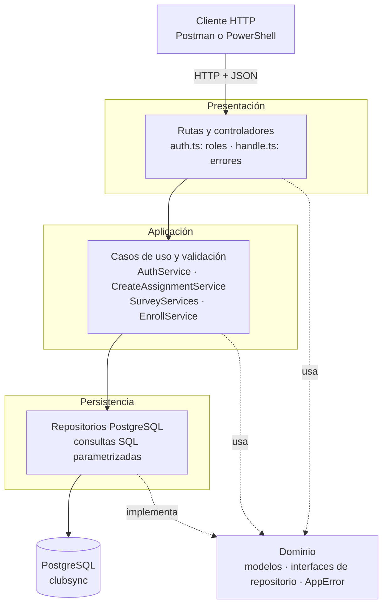
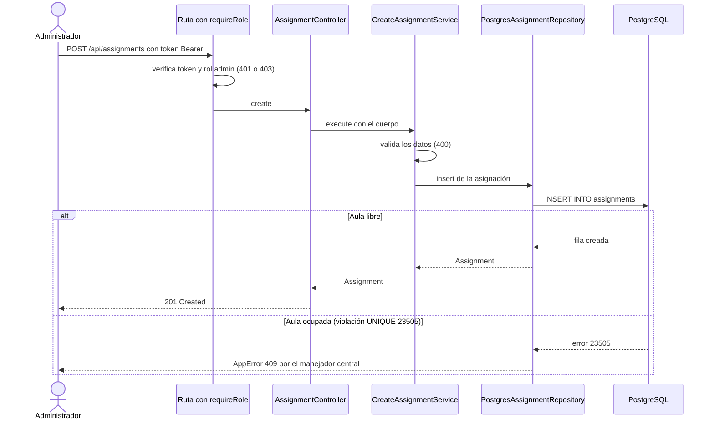
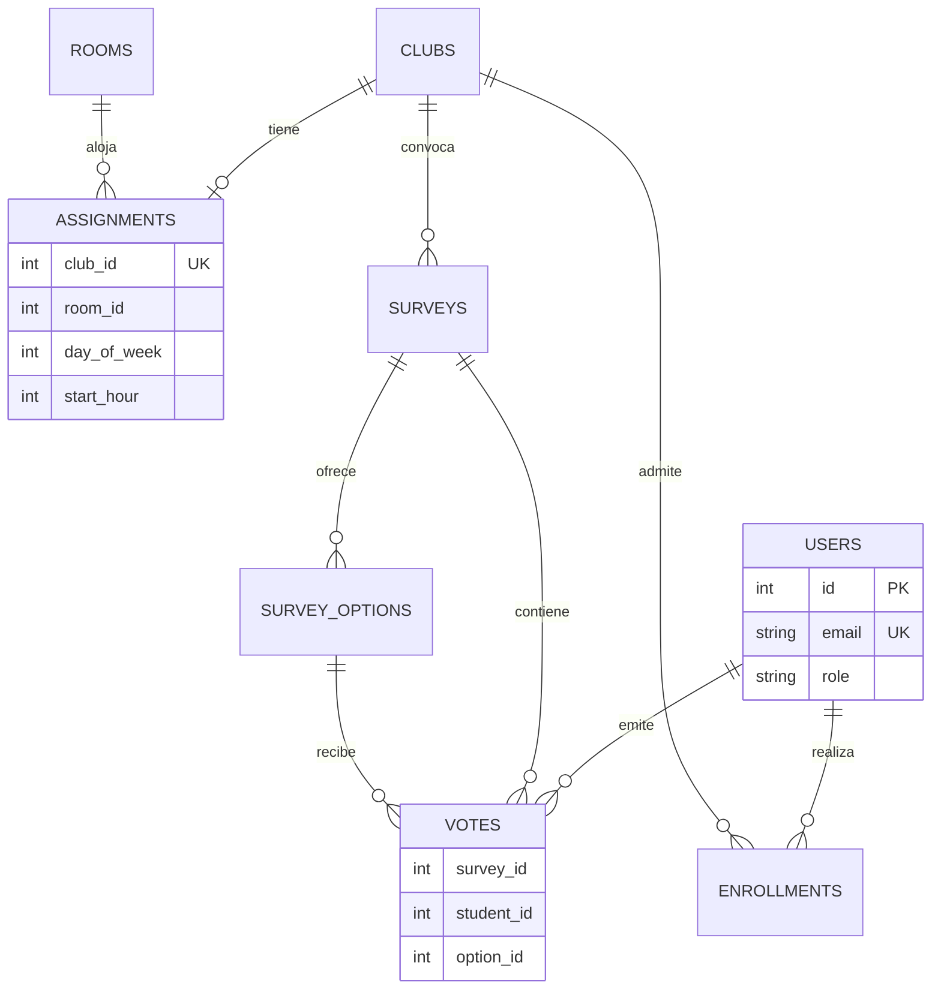

# Arquitectura de ClubSync

Monolito en capas con Node.js, TypeScript, Express y PostgreSQL.

## 1. Capas y dependencias

| Capa | Responsabilidad | No debe hacer |
|---|---|---|
| Presentación | Recibir la solicitud HTTP, verificar el rol y responder con el código de estado | Reglas de negocio ni SQL |
| Aplicación | Coordinar cada caso de uso y validar las entradas | Conocer `req` o `res`, ni escribir SQL |
| Persistencia | Ejecutar consultas SQL y traducir errores de la base de datos | Validar reglas de negocio |
| Dominio | Modelos, interfaces de repositorio y `AppError` | Depender de otras capas |

Las dependencias van siempre hacia abajo. La aplicación depende de la interfaz del repositorio (dominio) y no de PostgreSQL, por eso los servicios se prueban con repositorios simulados.

## 2. Flujo de CS-01 Asignar horario y aula

Los demás casos (CS-02 a CS-05) siguen el mismo recorrido: ruta con rol, controlador, servicio, repositorio y base de datos. Los errores de negocio se lanzan como `AppError` y un único manejador en `app.ts` los convierte en la respuesta HTTP.

## 3. Modelo de datos

## 4. Reglas aplicadas en la base de datos

| Regla | Restricción | Escenario |
|---|---|---|
| R-01 Un aula no tiene dos clubes en el mismo horario | `UNIQUE (room_id, day_of_week, start_hour)` | QA-01 |
| Un club tiene una sola asignación | `UNIQUE (club_id)` | CS-01 |
| R-02 Un voto por estudiante y encuesta | `UNIQUE (survey_id, student_id)` | QA-07 |
| Una inscripción por estudiante y club | `PRIMARY KEY (club_id, student_id)` | CS-05 |
| R-05 Solo dos roles válidos | `CHECK (role IN ('admin', 'estudiante'))` | QA-02 |

La base de datos garantiza estas reglas incluso con peticiones simultáneas, y el repositorio traduce el error `23505` a `409` y el `23503` a `404`.

## 5. Decisiones de diseño

- **Monolito en capas:** un solo despliegue, simple de ejecutar y probar para el alcance del proyecto.
- **Interfaces de repositorio en el dominio:** permiten probar los servicios sin base de datos.
- **Autenticación con JWT y roles en la capa de presentación:** el control de acceso (QA-02) queda separado de las reglas de negocio.
- **Contrato OpenAPI como acuerdo con el cliente:** `docs/openapi.yaml`, publicado en `GET /openapi.yaml`.